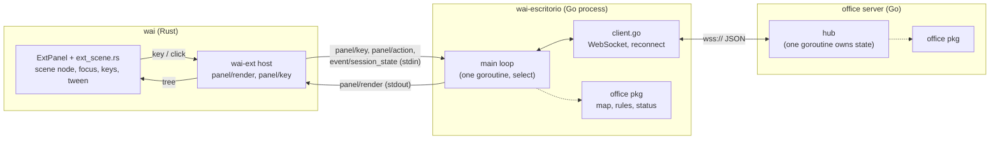
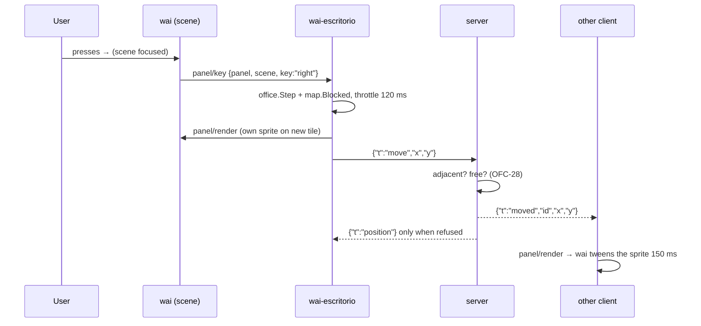

# Escritório Design

**Spec**: `.specs/features/escritorio/spec.md`
**Status**: Approved - 2026-11-26 - user: "aprovo"

---

## Architecture Overview

Three parts, built in this order:

1. **wai core (Rust):** a `scene` tree node and a `panel/key` notification, API 1.14. Generic: nothing in it knows about offices.
2. **`office` server (Go):** one binary holding who is where; the authority on positions.
3. **`wai-escritorio` extension (Go):** the setup form, the presence panel and the office pane; it talks JSON-RPC to wai and WebSocket to the server.



A move, end to end:



**Where the rules run.** Every rule a user sees runs in Go packages or Rust functions the tests reach: collision, adjacency, "Nearby" (Chebyshev ≤ 3), status derivation, name validation and the presence list order live in `office/` and the extension's view functions, tested with `go test`. wai's side (parse, viewport, tween, key routing) is tested with `cargo test`. Nothing is decided in drawing code alone.

---

## Code Reuse Analysis

### Existing Components to Leverage

| Component | Location | How to Use |
| --------- | -------- | ---------- |
| Panel schema + limits | `crates/wai-ext/src/panel.rs:59-217`, `parse()` :311, `leaf()` :724, id set :924-933 | Add `Node::Scene` beside `Pixels`; same Unsupported/TooLarge paths; `card()` (:317) already bars it from hover cards |
| `pixels` parse/render | `panel.rs:880-920`, `ext_panel.rs:280-336` | Template for the scene's parse and its clickable canvas |
| Bubble ticker | `ext_panel.rs:237-276` (`ensure_ticker`), `ext_bubble.rs` (pure timeline) | Same pattern for the sprite tween: a pure `tween(from, to, t)` + the existing ticker loop |
| Terminal key routing | `terminal_view.rs:166-181, 367-369` | Same shape: `track_focus` + `key_context` + `on_key_down`, skip `platform` keys, `stop_propagation` |
| Panel action path | `ext_panel.rs:452-455` → `ext_host.rs:437-441` → `host.rs:354-385` | `panel/key` follows it: `PanelKey` event → `ExtHandle::panel_key` → `Command::Send` notification |
| Hex colour parser | `appearance/overrides.rs:31-49`, gpui-kit `try_parse_color` | Parse the scene palette |
| `RenderImage` + `img()` | gpui-fast `assets.rs:43`, `elements/img.rs:46,201` | Paint the static tile layer once into an image |
| API version | `manifest.rs:96`, tests `wai-ext/tests/manifest.rs:295-320`, `tests/host.rs:128` | Bump to 1.14 |
| Fake extension | `crates/wai-ext/src/bin/wai-fake-ext.rs`, `tests/host.rs` | `panel/key` round trip test |
| Go protocol loop | `extensions/wai-bichinho/main.go:30-92, 538-705` | Copy the `message` type, `write`/`call`, `handle` switch and the `serve` select loop; add a channel for server messages |
| Extension release | `.github/workflows/extensions.yml`, `extension-release.yml` | Ships `wai-escritorio` on `wai-escritorio-v*` tags unchanged (`go build .` at the extension root) |
| Go CI | `.github/workflows/ci.yml:46-53` | Add `go vet ./... && go test ./...` for `extensions/wai-escritorio` |

### Integration Points

| System | Integration Method |
| ------ | ------------------ |
| wai sessions | `sessions:read`: `sessions/list` at start + `event/session_state` → `office.Derive` (OFC-50..54) |
| wai panels | `panels`: a `sidebar` panel `presence` and a `main` panel `office` |
| Office server | WebSocket (`github.com/coder/websocket`), JSON text frames |

---

## Components

### 1. Scene node schema (`wai-ext`)

- **Purpose**: Parse and validate the `scene` node (OFC-30, OFC-35).
- **Location**: `crates/wai-ext/src/panel.rs` (`Node::Scene(Scene)`, parse in `leaf()`), tests in its `#[cfg(test)]`.
- **Interfaces** (JSON, API 1.14):

```json
{
  "type": "scene", "id": "office",
  "cell": 16, "scale": 2,
  "palette": { "a": "#2b2238", "b": "#c9a27e" },
  "patterns": { "floor": ["bbbb…16 chars", "…16 rows"], "ana": ["  aa  ", "…"] },
  "legend": { ".": "floor", "#": "wall" },
  "map": ["#####", "#...#", "#####"],
  "sprites": [ { "id": "u1", "x": 2, "y": 1, "pattern": "ana", "label": "Ana", "badge": "Focused", "tone": "info" } ],
  "follow": "u1", "margin": 3
}
```

- **Rules** (any break → `Unsupported element`):
  - `id` required, joins the panel's id set (key events name it).
  - `cell` 4–32 (pattern px per tile); `scale` 1–4, default 2.
  - `palette`: at most 64 one-character keys → `#rgb`/`#rrggbb`; a space in a pattern is transparent.
  - `patterns`: at most 64, each at most 32 × 32; every pattern the `legend` uses is exactly `cell × cell`; sprite patterns may be smaller, drawn bottom-centred on their tile.
  - `legend` maps a map character to a pattern; a map character missing from it is drawn empty.
  - `map`: at most 128 rows × 128 characters; shorter rows padded.
  - `sprites`: at most 100; `x`/`y` inside the map; `label` ≤ 32 chars, `badge` ≤ 24, `tone` as elsewhere; sprite ids may repeat across trees, not within one scene.
  - `follow`: a sprite id; `margin` 0–16, default 3.
  - Counts as one node, like `table` rows; never allowed in a hover `card`.
- **Dependencies**: none new.
- **Reuses**: `leaf()` structure, `tone()`, the id set.

### 2. Scene view (`wai`)

- **Purpose**: Draw a scene, keep the followed sprite in view, tween moves, take focus and keys (OFC-30..34).
- **Location**: new `crates/wai/src/ext_scene.rs` (pure parts + element), called from the `Scene` arm of `ExtPanel::node` (`ext_panel.rs:669`). Kept out of `ext_panel.rs` (already 3,000+ lines).
- **Interfaces**:
  - `fn rasterise(scene: &Scene) -> RgbaImage` - the static tile layer, pure, unit-tested on pixel values.
  - `fn viewport(view: Size, map: Size, follow: Point, margin: u32, prev: Point) -> Point` - pure: smallest scroll keeping `follow` at least `margin` tiles from every edge; centred the first time (OFC-11, OFC-34).
  - `fn tween(from: Point, to: Point, elapsed: Duration) -> Point` - pure, linear over 150 ms; a jump of more than one tile is not tweened (OFC-31).
  - `struct SceneState { layer: (u64, Arc<RenderImage>), sprites: HashMap<String, Motion>, offset: Point }` per scene id in `ExtPanel`; `layer` re-rasterised only when the hash of palette + patterns + legend + map + cell changes.
  - Focus: `ExtPanel` gains a `FocusHandle`; the scene element is `.track_focus(..).key_context("ExtScene").on_mouse_down(focus).on_key_down(..)`. Keys with the `platform` or `control` modifier propagate (so ⌘ shortcuts keep working); others emit `PanelKey { scene, key, repeat }` and stop propagation (OFC-32, OFC-33).
  - While the scene is not focused, it shows a hint line "Click the map to walk" (builder's call; keeps the keyboard state visible).
- **Dependencies**: `RenderImage`, `img()`, the bubble ticker pattern.
- **Reuses**: `ensure_ticker` loop (30 ms), `tone_color()`, the terminal's key handler shape.

### 3. `panel/key` notification (`wai-ext` host)

- **Purpose**: Deliver scene keys to the extension (OFC-32).
- **Location**: `crates/wai-ext/src/host.rs` (`ExtHandle::panel_key`, beside `panel_action` :354), `crates/wai/src/ext_host.rs` (subscribe to `PanelKey` beside :437).
- **Interfaces**: host → extension **notification** `panel/key` `{"panel": "<panel id>", "scene": "<scene id>", "key": "<gpui key name>", "repeat": bool}`. Key names as GPUI gives them: `up`, `down`, `left`, `right`, letters lowercase, `space`, `enter`, `escape`, … Needs `panels`. No answer.
- **Reuses**: `send()` → `Command::Send` → bounded outgoing queue (256).

### 4. API 1.14 and docs

- **Location**: `manifest.rs:96`, the tests listed above, `docs/extensions.md` (scene row in Content, `panel/key` row in Host → extension, the `api` field's version list, Rules ids list, version mentions at 7/48/158/169), `panel.rs:13`.
- Satisfies OFC-36.

### 5. `office` package (Go, shared)

- **Purpose**: The rules both binaries need, in one tested place.
- **Location**: `extensions/wai-escritorio/office/`.
- **Interfaces**:
  - `type Map struct { W, H int; Rows []string; Spawn Point }`, `func ParseMap(text string) (Map, error)` - errors "map has no spawn point" / "unknown tile 'x' at 3,4" (OFC-61); `func (m Map) Blocked(p Point) bool` (walls, furniture, outside: OFC-07).
  - `//go:embed default.map` - the built-in office, about 40 × 30, legend: `#` wall, `.` floor, `,` carpet, `D` desk, `C` chair, `P` plant, `T` table, `S` spawn (floor). Blocking: `#`, `D`, `P`, `T`.
  - `func Step(p Point, key string) (Point, bool)` - arrows and WASD → next tile; other keys → false (OFC-06).
  - `func Adjacent(a, b Point) bool` - one step, no diagonals (OFC-28).
  - `func Nearby(a, b Point) bool` - Chebyshev ≤ 3 (OFC-40).
  - `func Derive(states map[string]string) Status` - `needs_you` beats `working`; else none (OFC-50..52).
  - `func ValidName(s string) bool` - 1–32 runes, no control characters (OFC-02, OFC-63).
  - Wire types (Data Models below).

### 6. Office server (Go)

- **Purpose**: Accept connections, own positions, fan out changes (OFC-20..29, OFC-60..62).
- **Location**: `extensions/wai-escritorio/server/` (`package main`: `main.go`, `hub.go`, `config.go`), README section on running it. Not part of the extension package (the release builds only the module root).
- **Interfaces**:
  - `wai-escritorio-server -config office.json`, config `{"listen": "127.0.0.1:7420", "token": "...", "tls_cert": "", "tls_key": "", "map": ""}`. Refuses to start: token < 32 chars (OFC-21), non-loopback without cert and key (OFC-22), bad or missing map file (OFC-61).
  - `func authenticate(h Hello, token string) (Identity, error)` - the one place that decides who a connection is (OFC-27); `subtle.ConstantTimeCompare`. Identity = name; avatars carry a server-assigned id (random, stable per name for the run).
  - Hub: one goroutine owns `people map[id]*person` and `last map[name]Point`; connections talk to it over channels. Same name → close the older with `refused{reason:"replaced"}` (OFC-12). 51st → `refused{reason:"full"}` (OFC-26).
  - Per connection: `SetReadLimit(16 KiB)` (OFC-25), a one-second window counter dropping messages past 30 (OFC-24), ping every 3 s with a 7 s deadline so a dead peer leaves within 10 s (OFC-10).
  - Log: one `log.Printf` line per connect, disconnect, refusal: address, name, reason, never the token (OFC-23, OFC-29).
- **Dependencies**: `github.com/coder/websocket`.
- **Reuses**: `office` package.

### 7. `wai-escritorio` extension (Go)

- **Purpose**: Setup, presence panel, office pane, agent status (OFC-01..14, OFC-40..54).
- **Location**: `extensions/wai-escritorio/` (`main.go`, `setup.go`, `client.go`, `views.go`, `art.go`, `wai-extension.toml`, `README.md`).
- **Manifest**: `api = "1.14"`, permissions `process`, `panels`, `sessions:read`, `network`; panels `presence` (sidebar, icon `users`, title "Office") and `office` (main, icon `map`, title "Office").
- **Interfaces**:
  - `main.go`: bichinho's `serve` loop + a `from <-chan serverMsg` case. Handles `initialize`, `panel/action`, `panel/key`, `event/session_state`, the `sessions/list` answer.
  - `setup.go`: `type Setup {Name, Server, Token, Avatar}`; load/save `setup.json` in `data_dir`, written with mode 0600 (OFC-13); `validate(Setup) string` returns the message to show. Also refuses `ws://` to a non-loopback host: "Use wss:// for a server that is not on this computer" (the token must not cross a network in clear text; mirrors OFC-22 on the client).
  - `client.go`: `run(ctx, Setup, to chan<- serverMsg, from <-chan clientMsg)` dials, sends `hello`, reconnects every 5 s on failure (OFC-04, OFC-60), stops for good on `replaced` (OFC-12) and on `token` (back to the form, OFC-03).
  - Moves: on `panel/key`, `office.Step` → `map.Blocked` → at most one move per 120 ms (held keys repeat at that pace) → optimistic render → send; a server `position` snaps back (OFC-28).
  - Status: `sessions/list` at start + `event/session_state` → `office.Derive`; sends `status` only when it changes, carrying only the derived value (OFC-53, OFC-54).
  - `views.go`: pure tree builders, tested on their JSON: `setupTree`, `presenceTree(state)` (sorted by name; "Nearby" badge; "Nobody else is in the office"; "Offline" + reason), `officeTree(state)` (the scene, follow = own sprite, sprites with label + status badge).
  - `art.go`: palette and patterns: floor, carpet, wall, desk, chair, plant, table, and 8 avatars, all original 16 × 16 pixel art.
- **Reuses**: bichinho's protocol plumbing and its tree-in-Go style; `office` package.

---

## Data Models

Wire messages (JSON text frames, field `t` is the type). Defined once in `office/wire.go`.

```go
type Point struct{ X, Y int }

// client → server
type Hello  struct{ T, Token, Name string; Avatar int }   // t:"hello", first frame only
type Move   struct{ T string; X, Y int }                   // t:"move"
type SetStatus struct{ T string; Status Status }           // t:"status"

// server → client
type Person  struct{ ID, Name string; Avatar int; X, Y int; Status Status }
type Welcome struct{ T, You string; Map []string; People []Person } // t:"welcome"
type Joined  struct{ T string; Person Person }             // t:"joined"
type Moved   struct{ T, ID string; X, Y int }               // t:"moved"
type Left    struct{ T, ID string }                         // t:"left"
type StatusChanged struct{ T, ID string; Status Status }    // t:"status"
type Position struct{ T string; X, Y int }                  // t:"position", correction
type Refused struct{ T, Reason string }                     // t:"refused": "token" | "full" | "replaced"

type Status string // "" | "focused" | "needs_you"
```

```go
// extension data_dir/setup.json, mode 0600
type Setup struct{ Name, Server, Token string; Avatar int }
```

**Relationships**: `Welcome.Map` carries the layout so the server is the only source of the map; the art (palette, patterns) lives in the extension.

---

## Error Handling Strategy

| Error Scenario | Handling | User Impact |
| -------------- | -------- | ----------- |
| Server unreachable | `client.go` retries every 5 s | Presence: "Offline", "Cannot reach <address>" (OFC-04, OFC-43) |
| Wrong token | Server sends `refused{token}` and closes; client stops retrying | Setup form with "The server refused the team token" (OFC-03) |
| Office full | `refused{full}`; client retries every 5 s | "Offline", "The office is full" (OFC-26) |
| Same name elsewhere | `refused{replaced}` to the older; no retry | "Offline", "Signed in elsewhere" (OFC-12) |
| Dead peer (no FIN) | Ping deadline 7 s after a 3 s ping | Avatar gone for others within 10 s (OFC-10) |
| Server restarts | Clients reconnect within 5 s; positions reset to spawn | Brief "Offline" (OFC-60) |
| Illegal move | Server ignores it, sends `position` | Avatar snaps back (OFC-28) |
| Bad scene JSON | Parser → `Unsupported` | "Unsupported element" in the pane (OFC-35) |
| Extension crash | wai restarts it (3×), the office pane closes | wai's normal `Crashed` state |
| `ws://` to a remote host | Refused in `validate` before dialing | Setup form message |

---

## Risks & Concerns

| Concern | Location (file:line) | Impact | Mitigation |
| ------- | -------------------- | ------ | ---------- |
| An extension pane focuses the Workspace root, not the panel | `workspace.rs:1396-1405` (`focus_pane` fallback), `:3555-3567` capture handler | A click on the map could leave focus on the root and keys never reach the scene | The scene's own `on_mouse_down` runs after the capture handler and focuses the scene; a test clicks the scene, presses → and asserts `panel/key` arrives (OFC-33) |
| Key bindings run before `on_key_down` | gpui-fast `window.rs:6500-6515` | A future bare-key Workspace binding would steal scene keys | Today every Workspace binding has `secondary`/`ctrl` (`app.rs:51-118`); add a test that arrows and WASD reach the scene |
| `RenderImage` byte order (BGRA on macOS) | gpui-fast `assets.rs:43` | Swapped red/blue | `rasterise` returns plain RGBA and is unit-tested on known pixels; the conversion to the frame buffer is one function, checked once with `WAI_SHOT` |
| `ext_panel.rs` is very large | `ext_panel.rs` (3,000+ lines) | Hard to change safely | New code goes in `ext_scene.rs`; `ext_panel.rs` gets only the `Scene` arm and the focus handle |
| Outgoing queue drops when full | `host.rs:34, 845-855` (256, drop + warn) | Held keys could flood | Key repeat is ~30/s and the extension reads continuously; repeats past the 120 ms move pace are ignored by the extension, not queued by wai |
| Whole tree per render | `host.rs:703-748` (coalesced at 100/s) | 50 people moving → many ~20 KB renders | The tile layer is cached by hash, so a render re-parses JSON but never re-rasterises; incremental updates were weighed and declined (context.md) |
| First non-stdlib dependency in a Go extension | `extensions/*/go.mod` | Supply chain, release build needs module download | One small, maintained module (`github.com/coder/websocket`, no transitive deps); `go.sum` committed; AD-003 |
| Self-signed certificates | client TLS | A team using a self-signed cert cannot connect | README says: use a real certificate, or listen on loopback behind Caddy/nginx with TLS. A custom CA option is out of scope |
| Shared team token | `authenticate` | Anyone with the token can pick any name | Accepted for delivery 1 (user chose token); OFC-27 keeps login swappable in one function |
| Original art quality | `art.go` | The office may look rough | 16 × 16 patterns drawn in code, reviewed with a `WAI_SHOT` screenshot before the art task is done |

---

## Tech Decisions

| Decision | Choice | Rationale |
| -------- | ------ | --------- |
| Scene art format | Palette + char patterns in the tree, wai rasterises and caches | User picked "Paleta + padrões no JSON"; matches `pixels` and bichinho's art-in-code; no image decoding of extension files (AD-002) |
| Tween in wai, not the extension | wai interpolates 150 ms on tile change | 30 fps re-renders from Go would hit the 100 renders/s cap with several people moving |
| WebSocket library | `github.com/coder/websocket` | Go's standard library has no WebSocket; spec fixed WebSocket (AD-003) |
| Server config | JSON file (`encoding/json`) | Standard library; TOML would need a dependency |
| Server state | One hub goroutine, channels | No locks; ordering is the hub's receive order |
| Map source | Server sends layout in `welcome`; art stays in the extension | One authority for collision; the server needs no art |
| Movement pace | One tile per 120 ms while held | Close to Gather's walking speed; stays under the 30 msg/s server cap |
| Where the server code lives | `extensions/wai-escritorio/server/`, same Go module | Shares the `office` package; the extension release builds only the root, so users never download it |
