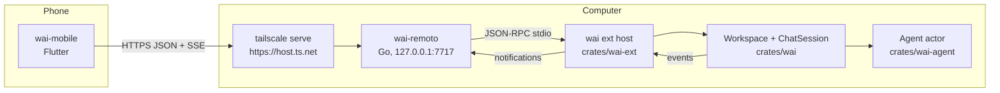
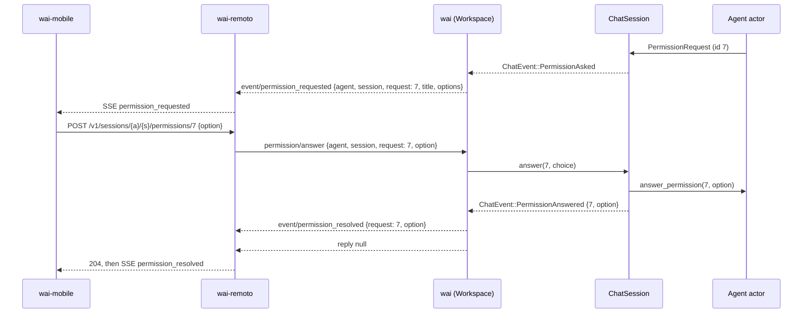

# Remote access Design

**Spec**: `.specs/features/remote-access/spec.md`
**Status**: Approved (with the tasks, 2026-11-20)

---

## Architecture Overview

Three parts, each in the language its home already uses:

1. **wai host (Rust)** gains extension API 1.10: the `listen` permission, `sessions/read`, `sessions/cancel`, `permission/answer`, `question/answer`, and the events `session_update`, `permission_requested`/`resolved`, `question_requested`/`resolved`.
2. **wai-remoto (Go extension)** turns that API into an HTTP API on `127.0.0.1:<port>`. It handles pairing, tokens, limits and Server-Sent Events, and renders its panel (settings, QR code, devices).
3. **wai-mobile (Flutter, separate repo)** pairs by QR code, then lists sessions, shows transcripts live, and sends prompts, cancels and answers.



Answering a permission from the phone:



The first answer wins. `ChatSession::answer` already handles an answer that arrives after the agent resolved the request: the agent returns `Err`, and the card closes as resolved. A `permission/answer` for a card that is no longer pending gets an error before it reaches the agent (HOST-07).

---

## Code Reuse Analysis

### Existing Components to Leverage

| Component | Location | How to Use |
| --------- | -------- | ---------- |
| Ext→host dispatch with permission checks | `crates/wai-ext/src/host.rs:519` (`call`) | Add the four methods beside `sessions/prompt` |
| Host events and their permission | `crates/wai-ext/src/host.rs:100` (`HostEvent`, `message`) | Add five variants, all needing `sessions:read` |
| Permission parsing, display | `crates/wai-ext/src/manifest.rs:338`, `:238` | Add `listen`; bump `API` to `"1.10"` (`manifest.rs:96`) |
| Extension session calls | `crates/wai/src/workspace.rs:1914` (`session_call`) | Route the new `ExtEvent`s; logic lives in a new module |
| Session state broadcast | `crates/wai/src/workspace.rs:1327` (`ChatEvent::StateChanged`) | Same subscription carries the new chat events |
| Answer a permission | `crates/wai/src/chat/view.rs:1019` (`ChatSession::answer`) | Called with the extension's option; already first-answer-wins |
| Answer a question | `crates/wai/src/chat/question.rs:311` (`answer_question`) | Called with the extension's `QuestionAnswer` |
| Cancel a turn | `crates/wai/src/chat/view.rs:644` (`ChatSession::stop`) | `sessions/cancel` calls it |
| Transcript | `crates/wai/src/chat/model.rs:41` (`ChatItem`), `model.items` | Serialized per item; pending `Permission`/`Question` items carry `answered: None` |
| Question form types | `crates/wai-agent/src/types.rs:294` (`QuestionRequest`, `FieldKind`, `QuestionAnswer`) | Serialized as-is; answer validated against them |
| Fake extension for host tests | `crates/wai-ext/src/bin/wai-fake-ext.rs`, `crates/wai-ext/tests/host.rs` | Extend to call the new methods |
| Go extension shape (stdio JSON-RPC, panel render, data dir) | `extensions/wai-rotinas/main.go`, `extensions/wai-bichinho/main.go` | Same loop and helpers in wai-remoto |
| `pixels` panel node (API 1.9) | `docs/extensions.md:287` | Draws the QR code: one `#` per dark module |
| Extension release workflow | `.github/workflows/extension-release.yml` | wai-remoto ships on `wai-remoto-v<version>` tags |

### Integration Points

| System | Integration Method |
| ------ | ------------------ |
| Agents (ACP) | Unchanged: wai-remoto acts only through `ChatSession`, like a click in wai |
| Tailscale | User runs `tailscale serve --bg <port>`; wai-remoto only shows the command and checks the URL's host |
| Phone | HTTPS through Tailscale; Bearer token per device |

---

## Components

### 1. Extension API 1.10 (wai-ext)

- **Purpose**: Expose session content and control to extensions under the existing permissions.
- **Location**: `crates/wai-ext/src/host.rs`, `manifest.rs`, `bin/wai-fake-ext.rs`, `tests/host.rs`, `tests/manifest.rs`; `docs/extensions.md`.
- **Interfaces** (ext→host):
  - `sessions/read {agent, session, from?: int, limit?: int}` → `{items: [Item], total: int}`, needs `sessions:content`. Default: the last 200 items; `limit` at most 500 (the 4 MB message cap).
  - `sessions/cancel {agent, session}` → `null`, needs `sessions:control`.
  - `permission/answer {agent, session, request: int, option: string}` → `null` or error, needs `sessions:control`.
  - `question/answer {agent, session, request: int, answer: "accept"|"decline"|"cancel", values?: object}` → `null` or error, needs `sessions:control`.
- **Interfaces** (host→ext, all need `sessions:content`):
  - `event/session_update {agent, session, total, items: [{index, item}]}`
  - `event/permission_requested {agent, session, request, title, options: [{id, name, kind}]}`
  - `event/permission_resolved {agent, session, request, option: string|null}`
  - `event/question_requested {agent, session, request, message, fields: [Field]}`
  - `event/question_resolved {agent, session, request, answer}`
- **`listen` permission**: parsed, displayed as `listen`, consent text "Listen for connections on a network port". Not enforced (like `network`).
- **`sessions:content` permission**: parsed, displayed as `sessions:content`, consent text "Read your sessions' conversations". Enforced by `call` and `HostEvent::message` like `sessions:read`.
- **Reuses**: `call`, `HostEvent::message`, `Reply`.

### 2. Transcript and answers (wai)

- **Purpose**: Turn the chat model into extension JSON, and apply an extension's answers through the same paths as a click.
- **Location**: new `crates/wai/src/ext_sessions.rs` (pure functions, unit-tested); thin routing in `workspace.rs` `session_call`.
- **Interfaces**:
  - `item_json(&ChatItem) -> Value`: `{"kind": "user"|"agent"|"thought"|"tool"|"permission"|"question"|"notice"|"edits", ...}`. A tool item carries `title`, `tool_kind` and `status`, never its output. A permission item carries `request`, `title`, `options` and `answered`. A question item carries `request`, `message`, `fields` and `answered`.
  - `page(items, from, limit) -> Value`: the `sessions/read` result.
  - `check_answer(&QuestionRequest, &Map<String, Value>) -> Result<(), String>`: required fields present, values fit the kind and choices (QST-05). The error names the field.
  - `Feed`: per-session dirty item indexes, flushed at most every 100 ms into one `event/session_update` (HOST-02).
- **ChatSession additions** (`chat/view.rs`): emit `ChatEvent::ItemsChanged(ix)` from `handle_event` and the card handlers; `PermissionAsked(id)`, `PermissionAnswered{id, option}`, `QuestionAsked(id)` and `QuestionAnswered{id, answer}` when a card opens or closes, by a click or an extension. Resolution by the agent (cancelled turn) sends `option: null`.
- **Dependencies**: `wai-ext` 1.10.
- **Reuses**: `ChatSession::answer`, `answer_question`, `stop`, `send_text`.

### 3. wai-remoto (Go extension)

- **Purpose**: An authenticated HTTP + SSE server on loopback that forwards to wai, plus its panel.
- **Location**: `extensions/wai-remoto/` (replaces the skeleton manifest; DESIGN.md is updated to the token model).
- **Manifest**: `api = "1.10"`, permissions `process`, `panels`, `sessions:read`, `sessions:content`, `sessions:control`, `notify`, `listen`; one sidebar panel `remoto`.
- **Files**:
  - `main.go`: stdio JSON-RPC loop, as in wai-rotinas.
  - `store.go`: `state.json` in `WAI_EXT_DATA`, mode `0600`. It holds the port, the tunnel URL and the devices.
  - `pair.go`: one-time codes.
  - `server.go`: mux and middleware.
  - `events.go`: SSE hub.
  - `panel.go`: tree.
  - `qr.go`: `rsc.io/qr` → `pixels` rows.
- **HTTP API** (all JSON, all `Cache-Control: no-store`):

  | Method & path | Auth | Result |
  | --- | --- | --- |
  | `POST /v1/pair {code, device}` | code | `200 {token}` / `401` |
  | `POST /v1/unpair` | token | `204` |
  | `GET /v1/sessions` | token | `200 [{agent, session, title, state}]` |
  | `GET /v1/sessions/{agent}/{session}?from=&limit=` | token | `200 {items, total}` |
  | `POST /v1/sessions/{agent}/{session}/prompt {text}` | token | `204` / `409` busy / `429` |
  | `POST /v1/sessions/{agent}/{session}/cancel` | token | `204` |
  | `POST /v1/sessions/{agent}/{session}/permissions/{request} {option}` | token | `204` / `409` already answered |
  | `POST /v1/sessions/{agent}/{session}/questions/{request} {answer, values?}` | token | `204` / `409` / `422 {field}` |
  | `GET /v1/events` | token | SSE: `session_state`, `turn_ended`, `session_update`, `permission_requested`, `permission_resolved`, `question_requested`, `question_resolved`; a `: ping` comment every 15 s |

- **Middleware order**:
  1. Reject an `Origin` header with 403 (EDGE-01).
  2. Check `Host` against the tunnel host or `127.0.0.1:<port>`, else 421 (EDGE-02).
  3. Cap the body at 64 KB, else 413 (EDGE-04).
  4. Look up `Authorization: Bearer` by SHA-256, else 401 (EDGE-03), counting the failure (EDGE-06). A match renews `last_used` (DEV-05).
  5. Per-device limits: prompts 30 a minute (REMO-14), 4 open streams (EDGE-05).
- **Prompt to a busy session**: wai-remoto keeps each session's state from `event/session_state` and answers 409 unless it is `idle` (EDGE-08).
- **Dependencies**: `rsc.io/qr` v0.2.0 (BSD-3-Clause); otherwise the standard library.

### 4. wai-mobile (Flutter app)

- **Purpose**: The phone client.
- **Location**: `C:\Users\guilh\Project\wai-mobile` (own git repo, AD-001).
- **Structure**:
  - `lib/api/client.dart`: HTTP calls and the SSE parser.
  - `lib/api/models.dart`: `Session`, `Item`, `PermissionCard`, `QuestionCard`, `Field`.
  - `lib/state/`: `SessionsStore` and `TranscriptStore`. These apply snapshots and events and decide what each screen shows: state labels, which buttons are enabled, "Answered in wai", whether Submit is allowed.
  - `lib/screens/`: `PairScreen`, `SessionsScreen`, `SessionScreen`, `QuestionForm`.
- **Packages**: `http`, `mobile_scanner` (QR), `flutter_secure_storage` (token).
- **Rules live in `lib/state`**: plain Dart, tested by `flutter test`. Screens only render store state and forward taps. Widget tests cover the controls' gestures.

---

## Data Models

### wai-remoto `state.json` (`0600`, in `WAI_EXT_DATA`)

```go
type State struct {
    Port      int      `json:"port"`       // default 7717
    TunnelURL string   `json:"tunnel_url"` // https://...
    Devices   []Device `json:"devices"`
}
type Device struct {
    ID        string    `json:"id"`         // random, 16 bytes hex
    Name      string    `json:"name"`       // sent by the app at pairing, ≤ 64 chars
    TokenHash string    `json:"token_hash"` // hex SHA-256 of the token
    Paired    time.Time `json:"paired"`
    LastUsed  time.Time `json:"last_used"`  // expiry = LastUsed + 30 days
}
```

Pairing codes live in memory only: `{code, expires}`, one at a time.

### QR payload

`wai-remoto:pair?url=<tunnel URL, escaped>&code=<code>`. The code is 16 random bytes, base64url (22 chars). The token is 32 random bytes, base64url. Level M; the URL plus code fits version 6 (41 modules), 49 rows with the quiet zone, under the `pixels` limit of 64.

### Transcript item (host JSON, shared by `sessions/read` and `session_update`)

```json
{"kind": "agent", "text": "…"}
{"kind": "tool", "title": "Edit main.rs", "tool_kind": "edit", "status": "completed"}
{"kind": "permission", "request": 7, "title": "Run cargo test", "options": [{"id": "allow", "name": "Allow", "kind": "allow_once"}], "answered": null}
{"kind": "question", "request": 3, "message": "Which branch?", "fields": [{"key": "b", "title": "Branch", "description": null, "required": true, "kind": "single", "choices": [{"value": "main", "label": "main", "description": null}]}], "answered": null}
```

---

## Error Handling Strategy

| Error Scenario | Handling | User Impact |
| -------------- | -------- | ----------- |
| wai-remoto unreachable (Stop, tunnel down) | App HTTP/SSE error → `TranscriptStore` offline state | "Can't reach wai. Check that wai-remoto is started and Tailscale is connected" + Retry (REMO-06) |
| Token revoked or expired | 401 → app deletes token | Pairing screen (REMO-07) |
| Answer after someone else answered | Host error → wai-remoto 409 → app keeps the `resolved` event's label | "Answered in wai: <option>" (REMO-13) |
| Invalid question answer | Host error naming the field → 422 `{field}` | App marks the field; question stays open (QST-05) |
| Port in use at Start | `net.Listen` error → panel message | "Port <port> is in use" (PAIR-06) |
| Session closed while viewed | `sessions/read` error → 404 | App returns to the list |
| SSE dropped | App reconnects after 2 s, then re-reads the open session | Brief gap, no lost content |
| wai-remoto crash | wai restarts it (≤3); listener only after the user clicks Start again | Panel shows stopped |

---

## Risks & Concerns

| Concern | Location (file:line) | Impact | Mitigation |
| ------- | -------------------- | ------ | ---------- |
| Conversation content is more sensitive than session states | `docs/extensions.md:84` | An extension granted `sessions:read` could read transcripts | Resolved: new `sessions:content` permission (user picked A); `sessions:read` is unchanged |
| `workspace.rs` is 6,915 lines; adding logic there is fragile | `crates/wai/src/workspace.rs:1914` | Hard-to-test changes | Logic in `ext_sessions.rs` with unit tests; `workspace.rs` only routes |
| `sessions/prompt` drops a prompt to a busy session silently | `crates/wai/src/workspace.rs:1947` | Phone thinks it sent | wai-remoto answers 409 from its state cache (EDGE-08). A race between the cache and wai remains; the transcript shows the truth |
| Permission and question ids restart at 1 per agent | `crates/wai/src/workspace.rs:1216` | Two agents can share an id | Every API addresses `(agent, session, request)` |
| `listen` and `network` are not enforced | `docs/extensions.md` Security model | An extension can listen without asking | Known v1 limit (DESIGN.md); consent tells the user |
| `tailscale serve` passes the original `Host` header (assumed, not confirmed) | - | If it rewrites to `127.0.0.1:<port>`, the tunnel-host check never matches | Both hosts are accepted (EDGE-02); the first task with the tunnel checks the header it receives |
| `tailscale serve --bg <port>` syntax (from memory, not confirmed in this session) | - | Wrong command shown in the panel | Confirm against Tailscale's docs in the panel task |
| `rsc.io/qr` last released 2018 | `extensions/wai-remoto/go.mod` | Unmaintained dependency | Small, stable, BSD; QR encoding has not changed. A test decodes nothing but checks size and finder patterns |
| No Go or Flutter toolchain on this Windows machine; iOS needs macOS | - | Gates cannot run here | Tasks start with toolchain setup; iOS build and walk on the Mac |
| Host tests depend on the fake extension binary | `crates/wai-ext/src/bin/wai-fake-ext.rs` | New methods untested end to end | Extend the fake ext with the new calls |

---

## Tech Decisions

| Decision | Choice | Rationale |
| -------- | ------ | --------- |
| Transport | HTTP JSON + SSE | User picked "HTTP + SSE"; standard library only in Go |
| Credentials | Bearer token per device, stored as SHA-256 | Native client: no cookies or Origin; a copy of `state.json` pairs nothing |
| Where the HTTP server lives | In wai-remoto, not in wai | DESIGN.md: wai stays free of listening sockets; disabling the extension closes everything |
| Transcript size | `sessions/read` pages, default the last 200 items | Fits the 4 MB message cap |
| Tool output | Not sent to the phone | Spec asks for title and status; keeps updates small and secrets in tool output off the phone |
| Coalescing | 100 ms per session in wai | HOST-02's 10 per second; one timer per session with pending changes |
| QR rendering | `rsc.io/qr` into the `pixels` node | No image node exists; `pixels` draws exact cells |

Project-level decision recorded in `.specs/STATE.md`: AD-001.
