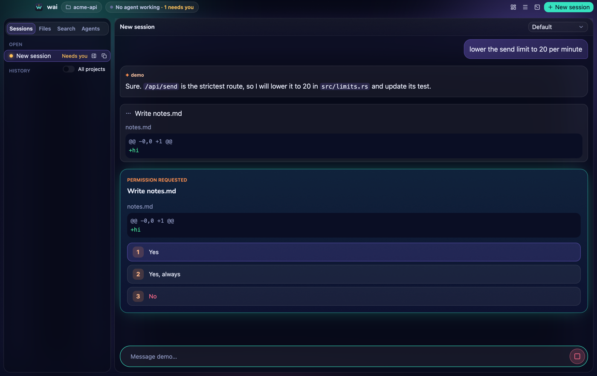
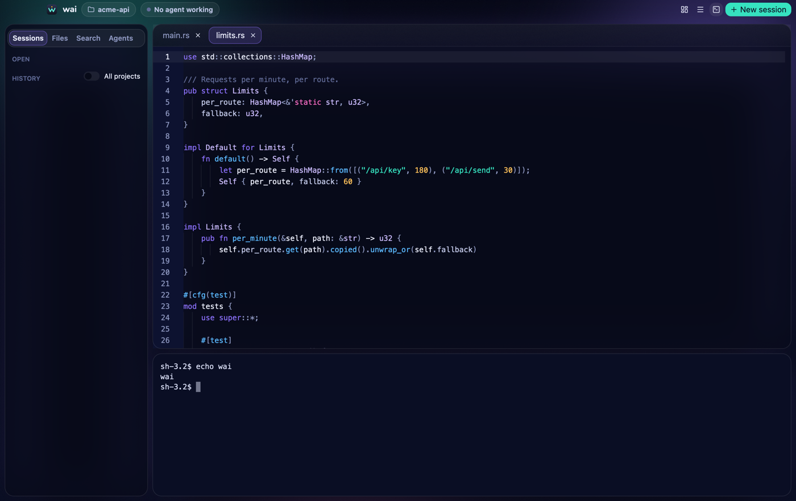
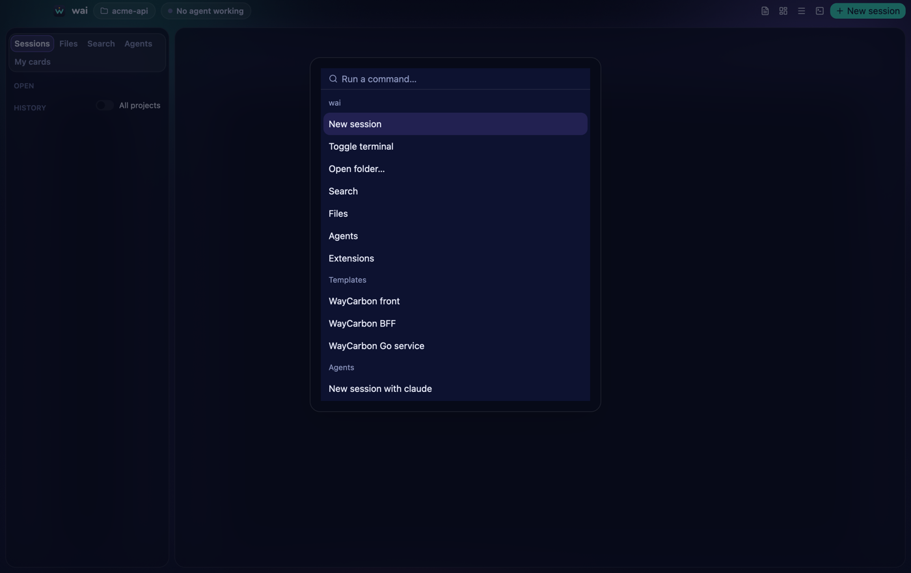
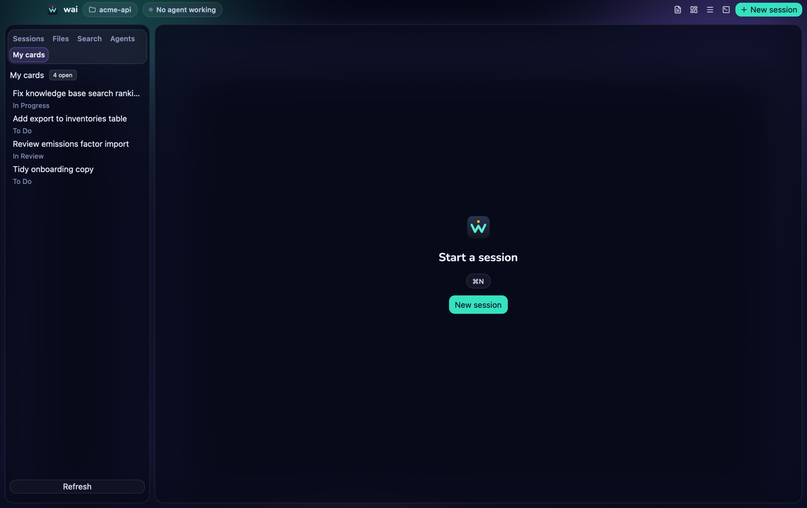

# wai

A native, AI-first IDE for macOS and Windows, written in Rust with GPUI.

- **Agents first.** wai drives coding agents through the [Agent Client Protocol](https://agentclientprotocol.com) (ACP).
  - Claude Code works out of the box through the `claude-agent-acp` adapter, with the login your Claude Code already has.
  - wai never shows a login screen and never reads, stores or forwards credentials.
  - Any other ACP agent is one line of settings.
- **An IDE around them.** Sessions side by side, permission cards with diffs, edit review with Revert, a file tree, an editor, project search and a real terminal.
- **Extensible.** Extensions are processes in any language. They speak JSON-RPC over stdio, draw native panels from JSON, and contribute agents, MCP servers, templates and commands.

|  |  |
|---|---|
|  |  |
|  |  |

**Status:** 0.4.0.
- macOS on Apple silicon is the primary platform.
- Windows x86_64 builds only in CI, and CI runs once the repository has a remote.
- Linux is best-effort.

## Requirements

- macOS on Apple silicon, or Windows x86_64.
- [Node.js](https://nodejs.org) with `npx`: the default Claude agent and npx-based MCP servers run through it.
- A signed-in [Claude Code](https://docs.anthropic.com/en/docs/claude-code), or another ACP agent.

## Install

### From the DMG

Open `wai_<version>_aarch64.dmg` and drag **wai** to Applications.

Until the project has signing certificates, the app is not signed or notarized, so macOS blocks the first launch of a downloaded copy. Either:
- try to open it once, then choose **Open Anyway** in System Settings → Privacy & Security; or
- remove the quarantine flag:

  ```sh
  xattr -dr com.apple.quarantine /Applications/wai.app
  ```

The Windows installer (`wai_<version>_x64-setup.exe`) is built by the release workflow only (CI-verified only).

### From source

You need [rustup](https://rustup.rs) (the toolchain in `rust-toolchain.toml` installs itself) and, on macOS, the Xcode Command Line Tools.

```sh
cargo build --release -p wai
target/release/wai path/to/project
```

To build the app bundle and DMG yourself, see [docs/building.md](docs/building.md).

## First run

- **Which folder opens:** `wai [FOLDER]` opens FOLDER. Otherwise it opens the last project, else the current directory. Launched from Finder or the Dock with no last project, it opens your home folder.
- **The agent:** there is no default agent. On the first run wai opens **Settings** on the **AI** section (`Choose an AI to start a session.`); pick Claude, Codex, Antigravity or Copilot there and it starts in the background. With `npx` agents, the first start downloads the adapter, which takes a few seconds.
- **Starting:** press **⌘N** for a session, **⌘,** for Settings, or **⌘⇧P** for the command palette.
- **Not signed in:** if the agent is not signed in, wai says so and does nothing else:

  > claude is not signed in. Open a terminal and run its login (for Claude: claude /login).

- **Settings** live in `~/.config/wai/settings.toml` (`%APPDATA%\wai\settings.toml` on Windows). See the [user guide](docs/user-guide.md#settings).

**Opened from Finder, the Dock or Launchpad, wai takes `PATH` from your login shell.** macOS gives such apps only `/usr/bin:/bin:/usr/sbin:/sbin`, which has no `npx`. So wai puts your shell's `PATH` (`$SHELL -i -l`) first. It caches that `PATH` and refreshes the cache in the background, so a change to it reaches wai one launch late.
- Started from a terminal (`open /Applications/wai.app`, or `wai`), wai uses the terminal's `PATH` instead.
- The first launch waits for the shell, up to 3 seconds, then keeps macOS's `PATH`. See the [user guide](docs/user-guide.md#agents-and-path) for that case.

## Known limitations

- **Signing:** builds are unsigned, and the Windows build is verified only by CI.
- **Extensions are not sandboxed:** they run with your user's rights. Install only those you trust.
- **What reopens:** editor tabs do not reopen at launch, though unsaved edits are recovered.
- **Revert:** it refuses tab-indented and CRLF files.
- **`.gitignore`:** the file tree and search honour it only inside git repositories.
- **Terminal:** the mouse wheel does not scroll inside full-screen programs such as `less` or `vim`.
- **One instance:** run one wai at a time. Two instances share the state and recovery files.

## Documentation

- [User guide](docs/user-guide.md): sessions, editor, search, terminal, shortcuts and settings.
- [Writing extensions](docs/extensions.md): the manifest, permissions, protocol, panels and examples.
- [Building and packaging](docs/building.md).
- For the project's owner (pt-BR): [the study](docs/ESTUDO.md) and [the final report](docs/RELATORIO-final.md).

## License

Not chosen yet.

Bundled: the Nunito font (`crates/wai/assets/fonts/`), under the SIL Open Font License 1.1.
