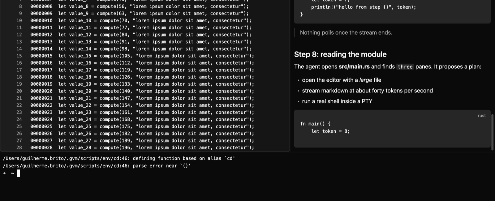

# S2 — GPUI: janela, editor, terminal e markdown em streaming (resultado)

> 2026-11-08 · `gpui-kit =0.9.0` (gpui-pre 0.3.11) · `alacritty_terminal 0.26` · `portable-pty 0.9` · Rust 1.99.1 ·
> macOS arm64, só Command Line Tools · código: `spikes/s2-ui` · guia da API: `docs/NOTES-gpui.md`

## Veredito: **GO com GPUI**, com quatro condições

A base é leve e não faz polling: abre em ~0,18 s, fica em **0,0 % de CPU** parada e usa **153 MB** sem arquivo grande.
Rolar um arquivo de 112 MB custa ~1 ms por quadro. Compila só com as Command Line Tools.

Condições (todas viram regra no plano da Fase 1):

1. **Editor sempre com `soft_wrap(false)`.** Com o padrão (`true`), o arquivo de 112 MB travou a tela por 53 s e
   usou 7,1 GB.
2. **Cursor que para de piscar:** `CursorBlink::default().with_idle_timeout(5 s)` no bootstrap. Sem isso, um editor
   com foco gasta ~0,9 % de CPU para sempre.
3. **Arquivo grande trava uma vez ao abrir:** ~0,36 s no `set_value` (meta: 0,1 s; corte: 1 s). Rolar não trava.
   O editor foi feito para ~50 mil linhas. Para o wai, que é uma IDE de agentes, isso basta; arquivo enorme fica
   para um "modo arquivo grande" (aviso + sem quebra), se um dia for preciso.
4. **Streaming custa CPU:** 40 tokens/s = 40 quadros/s a ~3 ms cada = **14–17 % de um núcleo** enquanto o agente
   escreve (parado volta a 0 %). Otimizar na Fase 1 (juntar atualizações, cache dos painéis que não mudaram).

## O que foi construído

Uma janela, três painéis redimensionáveis (`v_resizable`/`h_resizable`):

| Painel | Como |
|---|---|
| Esquerda: editor | `EditorState` do gpui-component com um arquivo gerado de **112 MB / 1,25 milhão de linhas** (`spikes/s2-ui/gen-big.sh` grava em `target/`). Leitura em background, depois `set_value` |
| Direita: markdown | `TextViewState::markdown` + `push_str`. Uma tarefa em background manda **40 tokens/s por 20 s** (títulos, listas, blocos de código) por um canal `smol`; a tarefa da UI só acorda quando chega token. Segue o fim do texto (`FollowMode::Tail`) |
| Baixo: terminal | Escrito do zero (sem código do Zed): `portable-pty` abre o `$SHELL`, uma thread lê o PTY e manda os bytes por canal, o `vte::Processor` alimenta o `alacritty_terminal::Term`, as linhas da grade viram texto monoespaçado. Teclas: caracteres, Enter, Backspace, Tab, Esc, setas, Ctrl+letra. Redesenha só quando chega saída do PTY |

Também: ação global `cmd-q`, atalho com contexto (`cmd-k` limpa o markdown), assinatura de eventos do editor e dois
testes `#[gpui_kit::test]` que passam:

- `keys_reach_the_shell`: digita num **shell de verdade** pelo PTY e confere a saída na grade (caracteres, Backspace,
  Enter, Ctrl+C interrompendo um `sleep 30`, seta para cima repetindo o comando);
- `scoped_binding_dispatches_action`: atalho com contexto chega à ação.

Como reproduzir: `spikes/s2-ui/gen-big.sh` e `cargo run -p s2-ui --release`. O log sai no stderr (`[s2] …`).
Variáveis: `S2_FILE=<arquivo>` (outro arquivo), `S2_SCROLL_TEST=1` (rolagem + tempos de quadro),
`S2_FORCE_DRAW=1` (tempo de quadro por token), `S2_WRAP=1` (quebra de linha ligada), `S2_FOCUS=editor`,
`S2_BLINK_IDLE=1` (cursor para de piscar após 5 s), `S2_LOAD_LOOP=n` (repete o `set_value` para o profiler),
`S2_SHOT=<png>` (screenshot; precisa de `--features test-support`). Testes:
`cargo test -p s2-ui --release --features test-support`.

## Números × metas

Medido no build `--release` deste Mac. CPU com `top -l 7 -s 5` (a 1ª amostra é descartada), memória pelo
"Physical footprint" do `vmmap` (o que o Monitor de Atividade mostra) e RSS do `ps`.

| Métrica | Meta | Medido | |
|---|---|---|---|
| Abrir → 1º quadro pintado | < 1 s | **160–222 ms** (mediana 177 ms, 5 aberturas); 598 ms na 1ª abertura a frio | ✅ |
| CPU parado, 30 s depois do stream (terminal com foco) | < 0,5 % | **0,0 %**, nenhum acordar novo da thread (`idlew` parado) | ✅ |
| CPU parado com o editor em foco | < 0,5 % | 0,9 % (cursor piscando); **0,0 %** com `with_idle_timeout(5 s)` | ✅ com ajuste |
| Memória sem arquivo grande | < 300 MB | **153 MB** footprint (RSS 94 MB); 273 MB logo após o stream com o editor em foco | ✅ |
| Memória com o arquivo de 112 MB | — | 545 MB footprint (RSS 558–664 MB, pico 916 MB): o arquivo custa ~3,5× o tamanho | ⚠️ |
| 100 MB: abrir | nada travar > 100 ms | leitura 13–80 ms em background; **`set_value` trava 340–380 ms** na thread da UI; 1º quadro depois disso: 2,5–3,5 ms | ❌ meta, ✅ corte |
| 100 MB: rolar | nada travar > 100 ms | quadro p50 0,63 ms / máx 1,2 ms (rolagem suave); p50 0,96 ms / máx 2,6 ms (pulos pelo arquivo todo) | ✅ |
| 100 MB com quebra de linha (padrão) | — | **53 s travado, 7,1 GB**. 50 mil linhas: 1,8 s (sem quebra: 13 ms) | ❌ não usar |
| Stream 40 tokens/s | atraso < 1 quadro | 800 tokens em 20 s, 1 quadro por atualização; quadro p50 2,8–3,1 ms, p95 4,4–5,5 ms, máx 9–20 ms; **CPU 14–17 %** durante o stream | ⚠️ |

O "Arquivo grande" e a memória são do arquivo, não da base: a meta de 300 MB (1 projeto, 3 sessões, 1 terminal)
fica com ~150 MB de folga. O spike não tem sessões de agente, então o custo delas fica para medir na Fase 1.

Os quadros do editor e do stream foram medidos forçando `window.draw()` e cronometrando (render + layout + paint, sem
GPU). O motivo está em "Limitações".

**Critérios de corte:** build só com Command Line Tools ✅ · CPU parado > 1 % ✅ não · RSS > 300 MB ✅ não (sem o
arquivo grande) · arquivo de 100 MB trava > 1 s ✅ não, desde que a quebra de linha esteja desligada.

## Windows

`rustup target add x86_64-pc-windows-msvc` + `cargo check -p s2-ui --release --target x86_64-pc-windows-msvc`:
~340 crates verificados, depois **parou no 1º erro**, que é de toolchain como esperado:

```
error: failed to run custom build command for `gpui-pre v0.3.11`
  panicked at gpui-pre-0.3.11/build.rs:46:10:
  called `Result::unwrap()` on an `Err` value: NotAttempted("llvm-rc")
```

O `gpui-pre-platform` liga a feature `windows-manifest`, que embute um manifesto `.rc` e precisa de um compilador de
recursos (`rc.exe` do MSVC ou `llvm-rc`). Nenhum erro de código Rust apareceu. Rodar a janela no Windows continua
pendente: precisa do CI `windows-latest` (Fase 3) ou de uma máquina Windows.

## Screenshot



`docs/screens/s2-ui.png`, aos 12 s do stream. A tela do Mac ficou **bloqueada a sessão inteira** e o `screencapture`
falhou. A imagem saiu do próprio GPUI (`window.render_to_image()`, renderização fora da tela; por isso sem a barra de
título). A faixa do terminal foi recortada da imagem, porque mostrava caminhos da pasta pessoal do dono.

## Limitações deste spike

- **Tela bloqueada:** não vi a janela de verdade. Também não testei teclado físico, IME, mouse nem arrastar os
  divisores. As teclas foram cobertas por testes com teclas simuladas. Com a tela bloqueada a entrega de quadros
  variou (numa execução, 3 quadros em 20 s), por isso os tempos de quadro foram medidos com `draw()` forçado.
  **Conferência de 2 minutos para fazer com a tela livre:**

  ```sh
  spikes/s2-ui/gen-big.sh && cargo run -p s2-ui --release   # digitar no terminal, rolar o editor, arrastar divisores
  top -l 7 -s 5 -pid $(pgrep -x s2-ui) -stats pid,cpu,mem    # depois de 25 s: CPU deve ficar em 0,0 %
  ```
- Terminal sem cores, seleção, scrollback nem redimensionar altura; programas de tela cheia (vim, htop) não testados.
- Realce de sintaxe (features `tree-sitter-*`) e dock com abas não foram compilados.

## Riscos

1. **Editor e arquivos grandes:** além da trava de 0,36 s e da quebra de linha, o `set_value` não roda fora da
   thread da UI pela API pública. Se um dia "abrir log de 1 GB" virar requisito, será um visualizador próprio.
2. **CPU durante o streaming (14–17 %)** precisa cair na Fase 1. Se não cair com cache e agrupamento de
   atualizações, rever o desenho do chat (ex.: um `TextViewState` por mensagem, só o último muda).
3. **Dependências frágeis:** ligar `gpui-kit/test-support` quebrou a resolução de versões (o `gpui-fast` fixa
   `taffy =0.15.0` e `unicode-properties =0.1.3`). Contornei ligando o test-support direto no
   `gpui-pre-platform`. Manter o `Cargo.lock` fixo e atualizar o GPUI de propósito, como já previa o ESTUDO.
4. **Windows** ainda sem nenhuma janela aberta (só o `cargo check` cruzado).
5. Já conhecido: `gpui-pre` mantido por uma pessoa só.

## O que muda no plano

1. Bootstrap do `wai`: `Theme::change` + `CursorBlink` com tempo de inatividade + `soft_wrap(false)` no editor.
2. Chat: `MessageScroller` (lista virtual com altura variável e "ir para o fim") + `TextViewState` por mensagem
   com `push_str`. Uma tarefa da Fase 1 mede e reduz o custo por quadro do stream.
3. Terminal: o desenho do spike (thread de leitura → canal → `Processor::advance` → `notify`) vale para o
   `wai-terminal`. Falta pintar as células com cor e tratar redimensionamento de altura.
4. Testes de UI: `#[gpui_kit::test]` + `allow_parking` para PTY e processos reais. O jeito de ligar o
   test-support está em `NOTES-gpui.md` §17–18.
5. Fase 3: o CI Windows precisa do compilador de recursos (`rc.exe`/`llvm-rc`) por causa do manifesto do GPUI.
